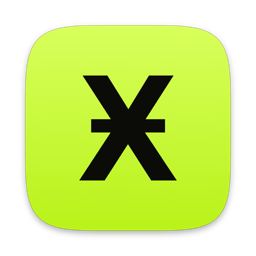

<p align="center">
  
</p>

<h1 align="center">XID Wallet for Mac</h1>

<p align="center">The post-quantum desktop wallet for xCoin (XID), as a native macOS app.<br>Send, receive, card wallets, and sign in to the MineDifferent forum with your XID identity.</p>

---

This is the Mac edition of the [Windows XID Wallet](https://github.com/SystemThreat/windows-xcoin-wallet-gui): the same app, the same wallet engine, the same screens. About 97% of the code is shared unchanged; the Mac build adds its packaging, the squircle icon, and forum sign-in (which the Windows app gets too).

## What you need

| | |
|---|---|
| A Mac with Apple Silicon (M1 or later) | The keytool is built for `arm64`. |
| macOS 12 Monterey or later | |
| Xcode Command Line Tools | `xcode-select --install` (gives `clang`, `codesign`, `iconutil`) |
| Python 3.12 or later | for example `brew install python` |
| Google Chrome | only to redraw the icon; the committed `xid-wallet.icns` is used otherwise |
| A USB card reader (optional) | for card wallets, for example an ACS ACR1252U |

## Build and install

```bash
git clone https://github.com/SystemThreat/apple-mac-xcoin-wallet-gui.git
cd apple-mac-xcoin-wallet-gui
gui/build-mac.sh --install
```

That one command:

1. Builds the native keytool (`./build.sh`, ML-DSA-65 and SLH-DSA from the vendored PQClean sources) and refuses to continue unless it passes the node's witness v3 golden vectors.
2. Makes a private build environment (`gui/.venv-mac-build`) with pywebview, qrcode, cryptography, truststore, pyscard and PyInstaller.
3. Packages **`dist/XID Wallet.app`** with the squircle icon, the screens, the wallet engine and the keytool inside, and signs it (ad hoc).
4. Quits a running copy, installs it to **`/Applications/XID Wallet.app`**, refreshes the Dock so the new icon shows, and opens it.

Without `--install`, it only builds `dist/XID Wallet.app`.

Open it later from Launchpad, Spotlight (type "XID Wallet") or the Applications folder. To keep it in the Dock: right-click its icon, Options, Keep in Dock.

> **Built here, runs here.** The app is signed ad hoc, so macOS trusts it on the Mac that built it. A copy sent to another Mac is blocked by Gatekeeper until it is signed with an Apple Developer ID and notarized.

## Use it

**First run**
- **New wallet:** the app makes a seed and shows it once. Write it down, then choose a passphrase that encrypts the wallet file.
- **Restore:** type a seed you already have, or open an existing `.mmm` wallet file (Unlock, Open another wallet file).
- Wallet files live in `~/.xcoin/` and are the same files the command-line wallet and MMM open.

**Every day**

| Screen | What it does |
|---|---|
| Overview | Balance, coins confirming, mined coins maturing (1,000 blocks), and the arithmetic of a transfer still waiting for a block: before − sent − fee = now. |
| Receive | Your address (key index 0) as text and QR code. |
| Send | Address and amount, a preview with the exact fee and change, then send. The transaction is signed on this Mac. |
| Coins | Every coin you hold, with confirmations and maturity. |
| Identity | Your XID identity and its tetromino mark, and **Sign in to MineDifferent**. |
| Settings | Day or night look, network (mainnet or testnet), explorer, wallet file, backup. |

The wallet locks itself after 10 minutes without use. The passphrase is kept in memory only while it is unlocked; the seed is decrypted for each action and never kept.

**Card wallets**
Put the card on the reader and leave it there, type the passphrase, then press **Unlock with card**.

**Sign in to the forum**
Identity, **Sign in to MineDifferent**. The app asks minedifferent.com for a challenge, signs it with your XID identity on this Mac (ML-DSA-65), sends back only the identity, its public key and the signature, and opens the one-time sign-in link in your browser.

## Keys

- **Funds are at key index 0.**
- **Your XID identity is key index 99,999,999**, the 100-millionth key: your public name on xCoin (the forum, AYEDEX). Nothing can be paid to it, and the app never receives at, shows or spends from that index.
- Every key index is its own SHAKE-256 child of the seed, so the identity cannot be traced to your balance.

## Build pieces

| File | What it is |
|---|---|
| `gui/build-mac.sh` | The Mac build and install described above. |
| `gui/assets/make_mac_icon.py` | Draws the icon: the official XID glyph on an acid lime squircle, on Apple's 1024 px icon grid (824 px body with continuous superellipse corners, soft shadow), then packs `xid-wallet.icns` with `sips` and `iconutil`. Run `python3 gui/assets/make_mac_icon.py` after changing it. |
| `gui/app.py`, `gui/backend.py`, `gui/ui/` | The app: pywebview draws the window with macOS's own WebKit; the page talks to Python through pywebview's bridge only (no web server, no open port). |
| `wallet_cli.py`, `card_seed.py` | The wallet engine shared with the command-line wallet. |
| `xcoin-wallet.cpp`, `pqcrypto/`, `build.sh` | The native offline signer (keytool). |

Run it without packaging, while developing:

```bash
python3 -m venv gui/.venv && gui/.venv/bin/pip install -r gui/requirements.txt pyscard
./build.sh
gui/.venv/bin/python gui/app.py
```

The screens can also be reviewed in a browser with sample data: serve `gui/ui/` and open `preview.html?screen=overview|receive|send|coins|identity|settings&theme=light|dark`.

## Tests

The tests need the app's own libraries, so run them with the build environment `gui/build-mac.sh` made:

```bash
gui/.venv-mac-build/bin/python -m unittest discover -s tests -q      # 370 tests, all must pass
```

## Check the source

`SHA256SUMS` lists the SHA-256 of every file in this repository except `README.md` and `SHA256SUMS` itself. From a fresh clone:

```bash
shasum -a 256 -c SHA256SUMS      # every line must say OK
```

## More

- [gui/README.md](gui/README.md): how the app is built inside, and the Windows builds.
- [RUN-YOUR-OWN-NODE.md](RUN-YOUR-OWN-NODE.md): use your own xCoin node instead of the explorer.
- Windows edition: [SystemThreat/windows-xcoin-wallet-gui](https://github.com/SystemThreat/windows-xcoin-wallet-gui).

License: see [LICENSE](LICENSE).
